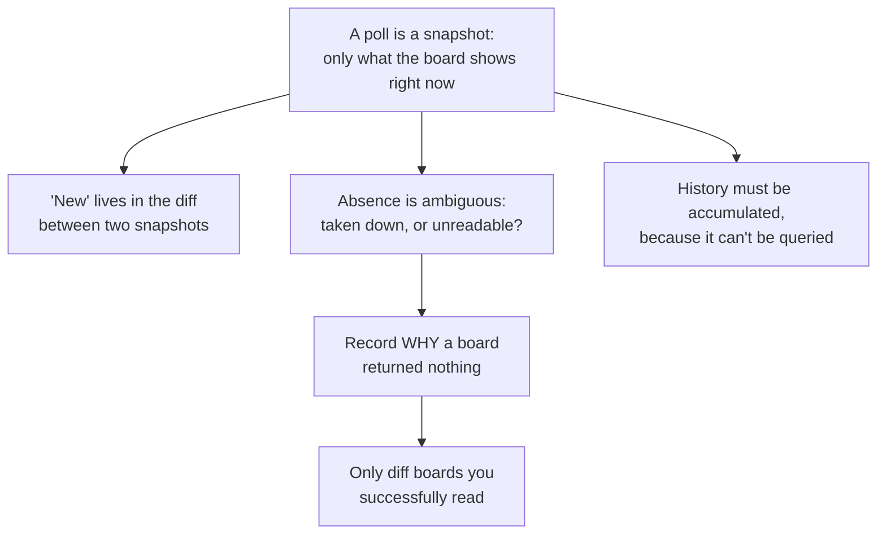
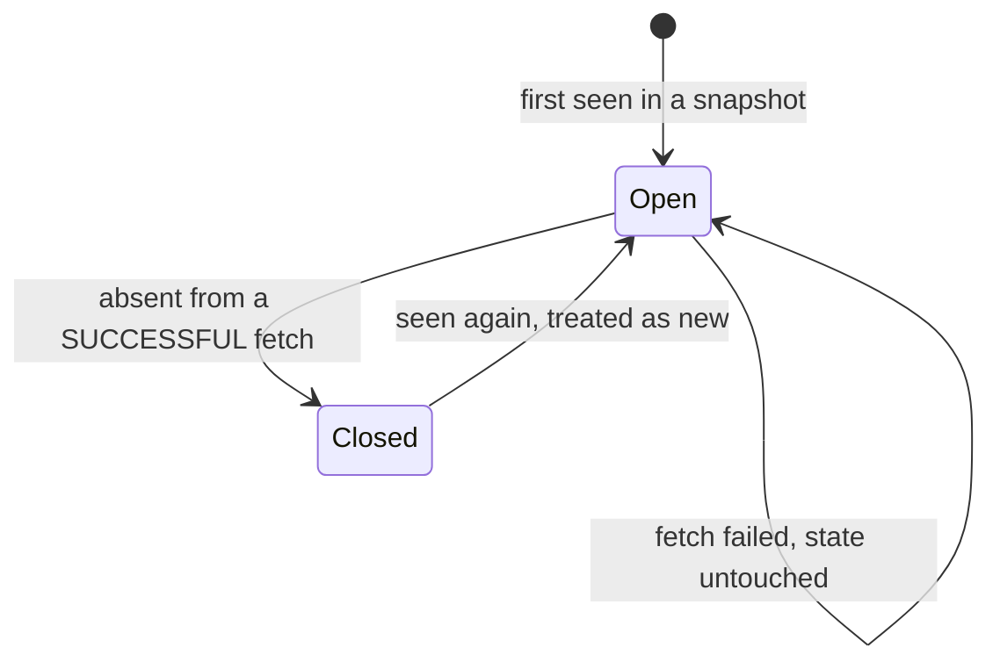
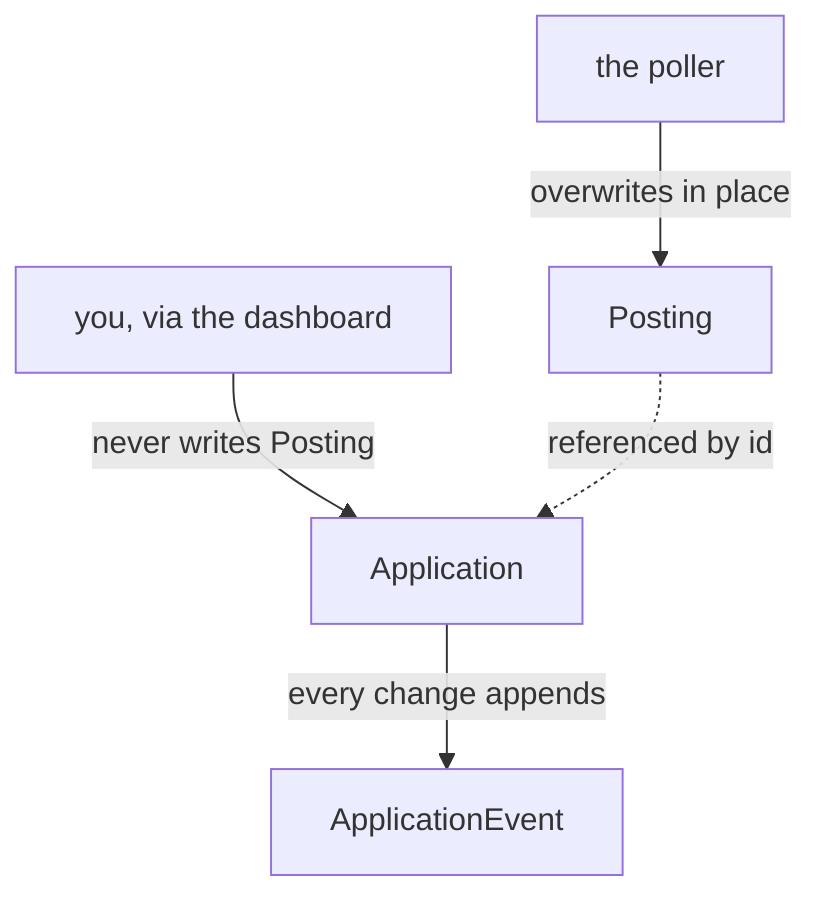

# How job_poller works

This explains the codebase by deriving it rather than describing it. Almost every
design decision in here follows from a single fact about the data source, and
once you see that fact the rest stops looking like a set of choices and starts
looking like consequences.

Assumes you're comfortable with Python. Does not assume SQLAlchemy, asyncio, or
anything about applicant tracking systems.

---

## 1. The one fact everything else comes from

Start with something you can accept with no caveats:

> **Every piece of job data in this system arrives as a snapshot: the complete
> list of what one company's board is advertising at the moment you asked.**

That's it. Not a stream of events. Not a feed of changes. No "what's new since
last Tuesday" parameter, because the ATS vendors don't offer one. You ask
`boards-api.greenhouse.io/v1/boards/stripe/jobs`, you get back every open Stripe
posting, and you get it with no indication of which ones are new.

Take a moment on that, because it's load-bearing. If you were handed that API and
asked to build an alerting tool, what's the first problem you'd hit?

**You cannot answer "what's new?" from a snapshot.** A snapshot has no concept of
new. Novelty isn't a property a posting carries — it's a property of the
*relationship between two snapshots*. The posting itself looks identical whether
it appeared an hour ago or has been up for six months.

Everything below is a consequence of that.



## 2. From "no concept of new" to a database

If novelty lives in the comparison, then to detect it you must have something to
compare *against*. So the program has to remember every posting it has ever seen.
That's the entire reason a database exists here — not because the data is big, but
because **state is the only place novelty can live.**

Once you accept that, the schema almost writes itself. For each posting you need:

- an identity stable across polls, so you can tell "the same posting again" from
  "a different posting" → `ats` + `external_id` + `company_id`, unique together
- when you first saw it → `first_seen_at`
- when you last saw it → `last_seen_at`

Look at `job_poller/models.py` and you'll find exactly those. `first_seen_at` is
the field the entire product rests on, and notice that it is **the program's own
observation, not the employer's claim.** The vendors do expose a published date
(`ats_posted_at`), but boards routinely omit it or reset it when someone edits a
typo. A timestamp you recorded yourself can't lie to you.

## 3. The hard part: absence means two different things

Now the interesting problem. You polled Stripe yesterday and saw posting #7412.
You poll today and it isn't there. What happened?

There are two possibilities, and **the data cannot distinguish them**:

1. Stripe took the posting down.
2. Your request failed — timeout, DNS blip, 500, rate limit — and you're looking
   at an empty or partial result.

This is the central problem in the codebase. Consider what happens if you guess
wrong in the permissive direction and treat "absent" as "closed":

- A single network hiccup while polling Stripe marks **all 722** Stripe postings
  closed.
- Five minutes later the next poll succeeds. All 722 are present again.
- Your code sees 722 postings that were closed and are now back, which is
  precisely the definition of a repost — so it fires 722 alerts.

One dropped packet, 722 emails. That's not a hypothetical; it's what the obvious
implementation does.

So the fix has to come *before* the diff: you must know whether a board was read
successfully, and that has to be recorded as data rather than inferred. That's
`FetchResult` in `job_poller/ats/base.py`:

```python
@dataclass
class FetchResult:
    board_token: str
    ats: str
    ok: bool                            # <- the whole point
    postings: list[RawPosting] = ...
    error: str | None = None
```

An empty list with `ok=True` means "this board genuinely has nothing." An empty
list with `ok=False` means "I don't know what this board has." Completely
different facts, and without the flag they're the same bytes.

Which gives the single most important line in the project, in
`poller.py`'s `apply_results`:

```python
if not result.ok:
    company.consecutive_failures += 1
    company.last_error = result.error
    outcome.failures.append(result)
    log.warning("board %s:%s failed: %s", result.ats, result.board_token, result.error)
    continue  # never diff a board we could not read
```

`continue`. Not "mark things closed," not "retry inline" — *leave the stored state
completely untouched.* A board you couldn't read contributes nothing in either
direction. This is why `tests/test_poller.py` has dedicated tests for it, and why
breaking it would be the most expensive regression available.

## 4. The posting lifecycle

With that rule in place, a posting's whole life is four transitions:



Two of these deserve attention.

**Closed is a stamp, not a delete.** `closed_at` gets set and the row stays
forever. Why keep rows you'll never show anyone? Because of the third consequence
in the diagram in §1: a snapshot API can tell you what's open now, and *nobody*
can tell you what was open last March. If you don't accumulate that, it's gone
permanently. It's the one asset in this project that compounds — a year of
polling answers "when does Shopify actually open summer co-ops?", and no job
board can answer that at any price.

**Closed → Open resets `first_seen_at` and re-alerts.** Look at `poller.py`:

```python
if existing.closed_at is not None:
    existing.closed_at = None
    existing.first_seen_at = now
    existing.notified_at = None
    outcome.new_postings.append(existing)
```

That looks like destroying history, and it's worth asking why it's right. A
company that pulls a role and reposts it has *re-opened* it — your first-wave
advantage resets with it, so it's genuinely the event you want to hear about.
Clearing `notified_at` is what permits a second alert. (The honest cost: the
original `first_seen_at` is overwritten. If you later want "how many times has
this role been reposted?", that data no longer exists — a reposting event table
would be the fix.)

## 5. Why `RawPosting` exists

Second unconditional truth, independent of the first:

> **Each ATS vendor returns a different JSON shape for the same information.**

Greenhouse puts the title in `title` and location in `location.name`. Lever puts
the title in `text` and location in `categories.location`. Ashby uses `title` and
`location`. Greenhouse dates are ISO strings; **Lever dates are epoch
milliseconds** — code that assumes ISO everywhere silently drops every Lever date
rather than erroring.

You have two options. Either every downstream component learns all three shapes,
or you convert once at the edge. The codebase converts at the edge: every adapter
returns `RawPosting`, and nothing past that boundary knows which vendor it came
from.

The payoff is concrete: `classify.py`, `apply_results`, the models, and the
notifiers contain **zero** vendor-specific code. Adding SmartRecruiters means
writing one file and adding one dict entry in `ats/__init__.py`. Nothing else
changes. That's not an abstraction added speculatively — it's the minimum needed
to stop three JSON schemas leaking through five modules.

## 6. Why the poller is async, and why adapters never raise

39 boards. Each request takes 100-600ms, almost entirely spent waiting on the
network rather than computing. Sequentially that's 20+ seconds of mostly idle
waiting; concurrently your real run was **2.1 seconds**.

Since the work is waiting rather than CPU, `asyncio` is the right tool — one
thread interleaving many in-flight requests. `fetch_all` issues them all at once:

```python
sem = asyncio.Semaphore(cfg.concurrency)   # at most 8 in flight
...
return await asyncio.gather(*(_fetch_one(client, sem, c, cfg) for c in companies))
```

Two things to understand here.

**Why a semaphore rather than just firing all 39?** These endpoints are free,
public, and run by someone else. Eight at a time is polite; 39 at once is a tiny
stampede, and the behaviour scales badly as `companies.yml` grows toward 300.

**Why does every adapter catch its own exceptions?** Look at `greenhouse.py`:

```python
except Exception as exc:  # noqa: BLE001 - one bad board must not stop the run
    return FetchResult(token, self.name, False, error=f"{type(exc).__name__}: {exc}", ...)
```

Normally catching bare `Exception` is a smell. Here it's the design. `asyncio.gather`
propagates the first exception raised by any task — so one company with an expired
TLS certificate would abort the entire run, including the 38 boards that were
fine. By converting failures into `ok=False` *values* rather than raised
exceptions, a failure becomes ordinary data that flows through the same path as
success. That's what makes "one bad board never stalls a run" true rather than
aspirational.

Notice also the retry logic:

```python
if result.error and "404" in result.error:
    break
```

A 404 is a permanent answer. Retrying it twice with backoff just wastes time and
somebody else's bandwidth. Retry what might change; don't retry what won't.

**One structural choice worth naming:** `fetch_all` is async and touches the
network; `apply_results` is synchronous and touches only the database. They're
deliberately separate functions. That's why the diff logic can be tested by
handing it hand-built `FetchResult` objects with no network, no mocks, and no
async test machinery — which is exactly how `tests/test_poller.py` works. When a
function is hard to test, the usual cause is that it does two kinds of work at
once.

## 7. Why classification is regex and not machine learning

A full poll returns **4,321 postings**. You want the ~204 that are internships or
new-grad roles. Something has to filter.

The filter is a few hundred regex patterns in `classify.py`. For a project in 2026
that deserves a justification, and there is a good one: **you need to know why a
given verdict happened.** When a Waterloo co-op posting doesn't show up, "the
model scored it 0.43" is useless, while "the `\bsenior\b` veto fired on
*Senior Software Engineer Intern*" tells you precisely which line to fix. Every
`Classification` carries a `reasons` tuple for that purpose.

Two details in there repay study.

**Word boundaries aren't decoration.** `r"\bintern\b"` rather than `"intern"`,
because `"intern"` matches **intern**ational, **intern**al, and
**intern**alization. The `\b` is the difference between a filter and a joke.

**The error costs are asymmetric, so the filter is deliberately lopsided.** A
missed posting costs you a job opportunity. A false positive costs you three
seconds of reading. Those are not remotely equal, so the code is tuned to prefer
false positives — most visibly here:

```python
elif is_remote and not _FOREIGN_ONLY_RE.search(location):
    # Bare "Remote" with no country. Keep it: a miss is the costly error.
    canada_eligible = True
```

A posting that just says "Remote" is genuinely ambiguous. The code keeps it. When
you're reasoning about any filter, work out which error is more expensive *first*
— the right threshold follows from that, and there's no neutral default.

The one place precision wins over recall is the seniority veto, and it carries a
nice exception:

```python
# An internship title plus a seniority marker usually means a role that
# *manages* interns -- but "Software Engineer Intern II" is a real posting,
# so only veto when the seniority word is not adjacent to an intern marker.
if category is not Category.OTHER and _SENIORITY_RE.search(title):
    if not re.search(r"\b(?:intern|co[\s\-]?op)\b\s*(?:ii+|[2-9])\b", title, re.IGNORECASE):
```

"Senior Manager, University Recruiting" must be rejected. "Software Engineer
Intern II" must not. The adjacency check separates them.

## 8. Why application status is a separate table

This is phase 1's main design decision, and it's the clearest example of the
codebase's reasoning style, so it's worth walking through.

The naive move is to add `status` and `applied_at` columns to `Posting`. One
table, no join, obviously simpler. It's also wrong, and §4 already told you why.

Re-read the repost code: when a posting reappears, the poller **overwrites
`first_seen_at` and nulls `notified_at` on that row.** `apply_results` also
rewrites `title`, `url`, `location` and the classification flags in place
whenever the fingerprint changes. `Posting` is not your row — it is the poller's
scratch space, rewritten whenever the employer edits anything.

Put `status = "applied"` in that row and you've stored your personal record of
having applied inside a row a background process rewrites on its own schedule.
Nothing would protect it.



Two writers, two tables, one foreign key between them. The poller can rewrite a
`Posting` as often as it likes and your application record is untouched.

There's a second reason, less fundamental but real: you'll track maybe 40
applications against 4,321 postings. Nullable columns on every posting row would
leave 99% of them empty. A sparse table of 40 rows is the honest shape.

And `ApplicationEvent` applies §4's lesson to your own data. Status isn't
overwritten either — every change appends a row:

```
(None → saved) → (saved → applied) → (applied → assessment) → (assessment → interviewing)
```

The current status is a convenience; the transitions are the real record. Store
only the current value and "how long do my applications sit before a response?"
becomes unanswerable, which is the same mistake job boards make with postings.

`tracking.py` owns this invariant on purpose. The event append and the
`applied_at` stamp both live inside `set_status`, so no caller can update a
status and forget the event. **When an invariant must always hold, put it where
it cannot be skipped** rather than documenting it and hoping.

## 9. Why the feed excludes anything you've touched

`queries.feed` returns postings that are open, classified as a match, **and have
no `Application` row at all.** So saving, applying, or dismissing all remove a
posting from the feed.

That seems harsh for "save for later" until you ask what the feed is *for*. It's
a triage queue, and a queue that can't empty isn't a queue. If saving left items
in place, "caught up" would be permanently unreachable and the feed would decay
into a list you scroll past. Saved items go to the pipeline's first column, where
they're still visible and no longer in your way.

### The one genuinely subtle bit: keyset pagination

Infinite scroll with `LIMIT 25 OFFSET 25` has a specific bug. Suppose you load
page 1 (newest 25), and while you're reading, the poller inserts 3 new postings
at the top. You scroll, requesting `OFFSET 25` — but every row has shifted down
by 3, so rows 23, 24 and 25 appear **a second time**. Postings duplicate in the
feed, and they duplicate more the longer you browse.

The fix is to stop counting positions and start remembering *where you were*:

```python
return or_(
    Posting.first_seen_at < seen_at,
    and_(Posting.first_seen_at == seen_at, Posting.id < posting_id),
)
```

Instead of "skip 25 rows", this says "give me rows older than the specific row I
stopped at." New arrivals at the top can't shift that boundary, because the
boundary is anchored to a row rather than to a count. `id` breaks ties when two
postings share a timestamp, which happens constantly since a cold start stamps
thousands of rows with the same `now`.

That's the whole trick, and it's why the cursor encodes `(first_seen_at, id)`
rather than a page number.

## 10. The bug the tests found that reading wouldn't have

Worth knowing because it's invisible on inspection.

SQLite has no timezone-aware datetime type. Declare a column
`DateTime(timezone=True)`, write an aware UTC timestamp, read it back — and
`tzinfo` is silently gone. Same instant, same microseconds, but now:

```python
stored_time == datetime.now(timezone.utc)   # False, even at the same instant
stored_time < datetime.now(timezone.utc)    # TypeError: can't compare
                                            # offset-naive and offset-aware
```

The original code worked around this by hand inside `Posting.days_open`, patching
`tzinfo` back onto both operands before subtracting. That works exactly where
someone remembered to do it — and the dashboard compares datetimes in several new
places (cursors, the feed-seen marker, poller staleness), each a fresh chance to
forget.

So it's fixed once, at the type layer:

```python
class UtcDateTime(TypeDecorator):
    impl = DateTime(timezone=True)

    def process_result_value(self, value, dialect):
        if value is None or value.tzinfo is not None:
            return value
        return value.replace(tzinfo=timezone.utc)
```

A `TypeDecorator` wraps a column type and hooks the convert-on-write and
convert-on-read steps. All 16 datetime columns use it, every timestamp in the
application is aware, and the manual workaround was deleted. **The general lesson:
when a workaround appears in more than one place, the fix belongs one layer
down.**

## 11. What is wired up, and what only looks wired up

Reading a codebase, it's easy to assume anything present is used. Three things
here aren't, and knowing which is which saves you an afternoon:

| Thing | Status |
|---|---|
| `RawPosting.dedupe_key()` | Computed, stored, indexed — and **no query reads it**. Written for cross-ATS dedupe that isn't built. The data is accumulating correctly, ready for it. |
| `PollConfig.max_response_bytes` | Declared and **never referenced**. Dead config. A huge Ashby board is currently unbounded. |
| `Classification.reasons` / `.interesting` | `reasons` is populated but nothing displays it; `interesting` is never called (callers compare `category != OTHER` directly). The debugging trace exists with no way to see it — a natural thing for the dashboard to surface. |

## 12. A reading order

17 modules, ~2,000 lines. Depth-first by dependency:

1. **`ats/base.py`** — `RawPosting` and `FetchResult`. The two shapes everything else speaks in. Start here; nothing makes sense before it.
2. **`ats/greenhouse.py`** — the simplest adapter, start to finish. Then skim `lever.py` and `ashby.py` only for how they differ.
3. **`models.py`** — the schema. With §2 and §8 in mind, every field should read as a consequence rather than a decision.
4. **`poller.py` → `apply_results`** — the heart of the project. Read it slowly. Every branch corresponds to a transition in §4's diagram.
5. **`classify.py`** — read the patterns last. It's the longest file and the least structurally interesting.
6. **`tracking.py`, `queries.py`** — phase 1. Short, and §8–§9 cover the reasoning.
7. **`cli.py`** — mostly `rich` table formatting. Read it when you need to change output.

Then read **`tests/test_poller.py`**, which is the best documentation in the repo:
it builds `FetchResult` objects by hand to drive the poller through a cold start, a
board timing out, and recovery, asserting at each step. `tests/demo_offline.py`
runs that same arc end to end with no network — run it, it prints what it's doing.

## 13. Check yourself

If the derivation landed, these should be answerable from the reasoning rather
than from memory:

1. A board returns HTTP 200 with `[]`. Another times out. Both produced zero
   postings — why must the code treat them completely differently, and what
   happens if it doesn't?
2. Why is `first_seen_at` more trustworthy than the vendor's own published date?
3. Why would adding `status` to `Posting` lose data, given the poller never
   deliberately touches it?
4. You load page 1 of the feed. A poll adds 3 postings. Why does offset
   pagination show you duplicates and keyset pagination not?
5. `classify.py` deliberately keeps postings whose location is just "Remote".
   What would have to change about the user for that to become the wrong call?

Answers to 1-4 are in §3, §2, §8 and §9. Number 5 has no single answer — it turns
on the cost ratio between a missed opportunity and a wasted three seconds, which
is a judgment about the person, not the code.
